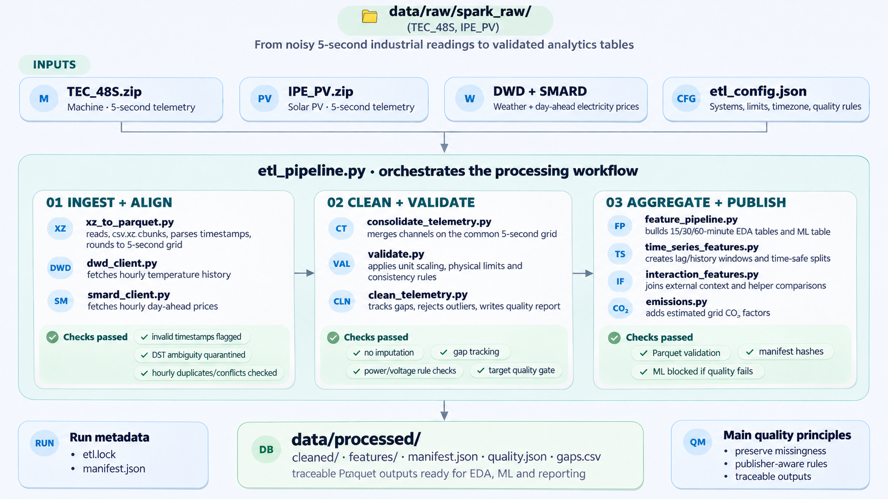
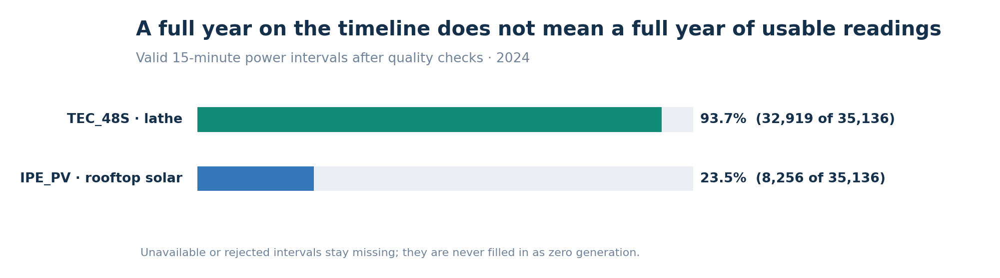
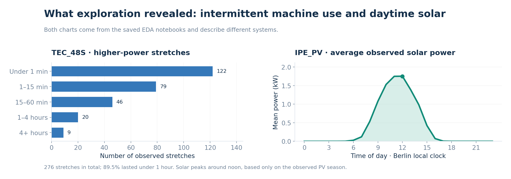
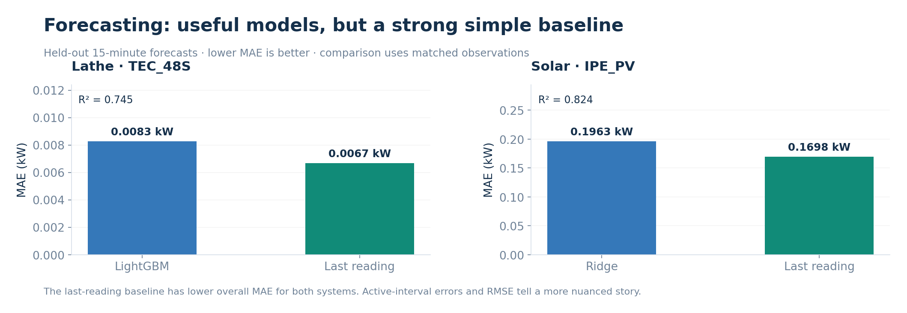
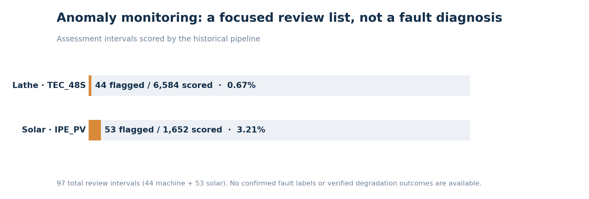
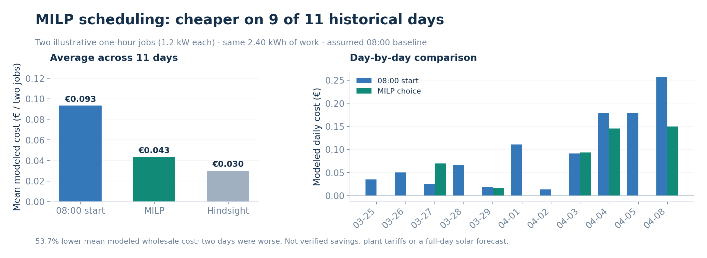

# AI_Powered Sustainable Manufacturing optimization

**GreenForge AI** · Applied data science for industrial energy forecasting, anomaly detection and smarter job scheduling

### [🚀 Explore the live dashboard](https://greenforge-ai.streamlit.app/)

*No installation needed — explore historical forecasts, anomaly reviews and scheduling results.*


## 📊 Overview

**The problem:** Industrial sensor data can be noisy or incomplete. Meanwhile, machine demand, solar generation and electricity prices change throughout the day. How can a factory turn these signals into **reliable information and better scheduling decisions**?

**What I built:** A **data science project** that studies energy use, predicts the next 15 minutes, flags unusual readings and tests better job schedules. Data engineering makes the raw measurements reliable; MLflow, FastAPI, Docker and Streamlit make the results reproducible and easy to explore.

**Results from the 2024 historical evaluation:**

| ⏱️ 15-min forecasting | 🔎 Anomaly monitoring | 💶 Modeled job cost | 🌱 Estimated CO₂ |
|:--|:--|:--|:--|
| **R² 0.745** machine · **0.824** solar | **97** intervals flagged for review | **↓ 53.7%** | **↓ 16.8%** |

*The cost and CO₂ reductions come from **11 historical days** of a hypothetical two-job schedule versus starting at 08:00. CO₂ uses a fixed emissions factor. These are **modeled results, not verified factory savings**; flagged anomalies are not confirmed faults.*

## 1. 🏭 Dataset: a lathe and rooftop solar

I used **[SPARK-Raw](https://radar.kit.edu/radar/en/dataset/8efkkn0g9pcng5yd)** from **Karlsruhe Institute of Technology (KIT)**: 5-second electrical measurements from 22 industrial machines and a photovoltaic system. I selected two 2024 sources:

- **`TEC_48S`** — a **VDF Boehringer 48 S lathe** in KIT's **TEC** workshop, used for precision metal turning. It represents changing **machine demand**.
- **`IPE_PV`** — a **10.72 kWp rooftop solar system** at KIT's **EPI** facility, equipped with SMA inverters. It represents variable **electricity supply**. The paper identifies it as `EPI_PV`; the downloaded archive uses `IPE_PV`.

These sites are separate. Combining their power in this project is a **what-if scenario**, not a verified shared electrical connection.

<p align="center">
  
</p>
<p align="center"><sub>Source publication: Sievers et al. (2026), <a href="https://doi.org/10.1038/s41597-026-06955-4">Figure 2 — monitored equipment</a> (CC BY 4.0). See the paper's numbered equipment key for the lathe and PV system.</sub></p>

<p align="center">
  
</p>
<p align="center"><sub>Photo: <a href="https://www.kit.edu/kit/202602-mehr-solarstrom-fur-forschung-am-kit.php">KIT photovoltaic installation</a> — illustrative campus photo, <b>not</b> the EPI array measured in this dataset.</sub></p>

## 2. 🛠️ Data engineering: making the raw data usable

The raw `.csv.xz` files contain **gaps, outliers, inconsistent units and off-grid timestamps**. I built an ETL pipeline to handle those problems without inventing measurements:

1. **Ingest:** Batch-read compressed sensor files; collect **DWD weather** and **SMARD electricity prices**.
2. **Align and clean:** Put readings on a 5-second grid; handle duplicates, source-specific units and physical checks.
3. **Validate:** Keep bad or missing readings explicit; verify power relationships and data coverage.
4. **Publish:** Build **15/30/60-minute Parquet** tables and ML features; write a provenance `manifest.json` with file hashes and safe publication checks.



**Why:** Reliable timestamps and honest gaps are essential for forecasting without data leakage and for avoiding false anomaly alerts.


*Machine coverage was much stronger than PV coverage; the available solar series ends in early April.*

## 3. 🔍 EDA: understanding when energy is used

The three [EDA notebooks](notebooks/EDA/) explore machine activity, solar production, weather, prices and an illustrative shared-energy balance.

- **Lathe:** Most higher-power activity happened in short bursts, suggesting intermittent operation rather than constant heavy demand.
- **Solar:** Production peaked around midday; missing data limited full-year conclusions.
- **Prices:** The day-ahead market varied enough to make **job timing** worth investigating.



## 4. 🧠 Models: predict, monitor, optimize

### Forecasting — what happens in the next 15 minutes?

I compared **Ridge, Random Forest, XGBoost, LightGBM and CatBoost** with lagged power, rolling statistics and calendar features. The application uses **chronological splits and training-only time-series CV** to avoid choosing a model on the test period.

- **Lathe:** LightGBM, **R² 0.745**.
- **Solar:** Ridge, **R² 0.824**.
- **Important:** A simple **last-reading forecast had lower overall MAE** for both systems. ML showed advantages in some active periods and on matched-row RMSE, but is not a universal improvement.



### Anomaly detection — what deserves a closer look?

I tested **PCA, Local Outlier Factor, Isolation Forest and K-Means**, separated lower/higher-load behavior and calibrated thresholds on earlier data. The final pipeline marked **44 lathe** and **53 solar** intervals for human review.



**Limit:** Without maintenance or fault labels, these are *review suggestions*, not diagnosed failures or proven degradation.

### MILP scheduling — can job timing reduce modeled costs?

Using **SciPy/HiGHS**, I scheduled **two illustrative one-hour jobs** within **08:00–18:00**, with consecutive execution and a grid-capacity constraint. The objective combines modeled electricity cost, solar scenarios and an emissions weight.

The genuine **08:00 PV forecast covers only 08:00–08:15**; the remaining 39 slots use **pre-test historical solar profiles**. Anomaly information is **advisory context**, not an automatic stop signal. Future measured solar is used **only to score** the chosen schedules.

**Outcome:** Across **11 historical days**, average modeled job cost fell from **€0.0933 to €0.0432 (↓ 53.7%)**; estimated CO₂ fell **16.8%**, driven by lower modeled grid imports. The schedule was cheaper on 9 days, but not all 11. These are **scenario results**, not measured factory savings.



## 5. 🧩 Architecture and technology stack


### 🧰 Technologies

| Area | Tools |
|:--|:--|
| **Data science & ML** |      |
| **Data preparation** |     |
| **Experiment tracking** |   |
| **Apps & visualization** |    |
| **Packaging & CI** |   |

- **Reproducible:** ETL validation and manifest hashes; time-safe splits; saved run-matched reports and MLflow models.
- **Tested:** Pytest for ETL, forecasts, anomaly logic, optimization and API contracts. GitHub Actions checks Python and **builds Docker images**, but does not deploy the Docker stack.
- **Two deployment paths:** **Public Streamlit Cloud** reads stored historical reports; **local Docker Compose** runs FastAPI + dashboard, with optional MLflow UI and saved-model inference.

### 📁 Project structure

```text
GreenForge-AI/
├── app/                         # Streamlit dashboard + FastAPI
├── data/                        # Local raw, external and processed data
├── src/greenforge_ai/
│   ├── ingestion/               # .csv.xz readers, DWD/SMARD clients
│   ├── transformations/         # Cleaning and physical validation
│   ├── features/                # Time-series and energy features
│   ├── pipelines/               # ETL, feature, training orchestration
│   ├── training/                # Forecasting, anomalies, evaluation
│   ├── optimization/            # MILP scheduler + constraints
│   └── utils/                   # Logging, locks, atomic publication
├── notebooks/EDA/               # Three exploratory notebooks
├── notebooks/model_training/    # Three model/optimization notebooks
├── reports/ml_short_term/
│   ├── notebook_runs/           # Research outputs
│   └── application_runs/        # Reports read by the public dashboard
├── mlruns/                      # Local MLflow artifacts
├── docker/                      # Dockerfile, Compose, requirements
├── tests/                       # ETL and unit tests
├── .github/workflows/           # CI tests + Docker build checks
├── etl_config.json              # ETL settings
├── requirements.txt             # Full Python dependencies
└── README.md
```

## 6. 🚀 Run the project

**Quickest way:** [Open the live dashboard](https://greenforge-ai.streamlit.app/).

**Run historical reports locally** (no raw-data download or backend required):

```powershell
git clone https://github.com/reza-mansouri1998/GreenForge-AI.git
cd GreenForge-AI
py -3.12 -m venv .venv
.\.venv\Scripts\Activate.ps1
python -m pip install -r app/requirements.txt
Remove-Item Env:GREENFORGE_API_URL -ErrorAction SilentlyContinue
python -m streamlit run app/streamlit_app.py
```

**Reproduce the full pipeline:** Download **`TEC_48S.zip`** and **`IPE_PV.zip`** from [KIT RADAR](https://radar.kit.edu/radar/en/dataset/8efkkn0g9pcng5yd), **unzip** each to `data/raw/spark_raw/TEC_48S/` and `data/raw/spark_raw/IPE_PV/`. Leave individual `.csv.xz` readings compressed. Install `requirements.txt`, provide the `publisher_schema.json` referenced in `etl_config.json`, then run:

```powershell
python -m greenforge_ai.pipelines.etl_pipeline --config etl_config.json
python -m greenforge_ai.pipelines.training_pipeline --stage all --compare-forecast-candidates
```

**Local Docker API + dashboard** (requires the saved `application_runs` reports and MLflow files):

```powershell
docker compose -f docker/compose.yaml up --build
```

Dashboard: `http://localhost:8501` · API docs: `http://localhost:8000/docs`.

## 7. ⚠️ Limitations and next steps

This is **historical research, not verified operational savings**. The PV record is short; real plant tariffs, job orders, physical PV sharing, price-publication timing and live sensor latency have not been verified. Anomalies have no fault labels. Next steps are **full-day forecasting, real production constraints and a controlled pilot**.

## 📚 Dataset and credits

- **SPARK-Raw:** Sievers, J., Blank, T., Bischof, S., et al. (2026), Karlsruhe Institute of Technology. [Dataset / CC BY 4.0](https://doi.org/10.35097/8efkkn0g9pcng5yd) · [Source publication](https://doi.org/10.1038/s41597-026-06955-4).
- **External inputs:** DWD weather and SMARD archived prices; CO₂ estimated with a fixed 2024 German annual factor (not marginal emissions).
- **Project source code:** [MIT License](LICENSE). Raw KIT sensor files are downloaded from the publisher, not redistributed here.
