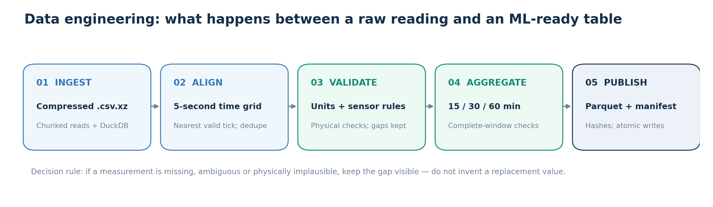
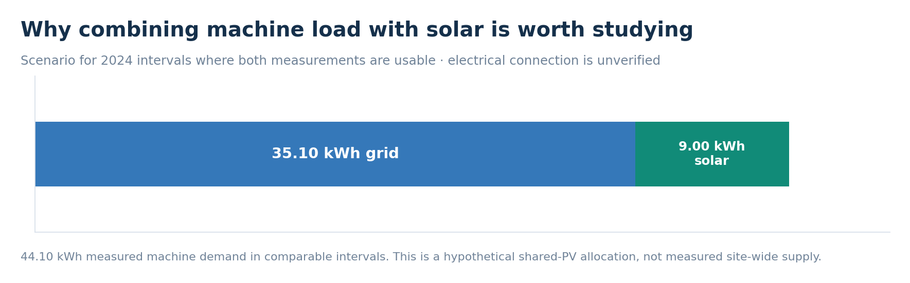

# AI_Powered Sustainable Manufacturing optimization

> **🚀 [Explore the live GreenForge AI dashboard](https://greenforge-ai.streamlit.app/)** — see the results, charts and schedules without installing anything.

**GreenForge AI** is my end-to-end industrial energy project: I turned noisy, five-second factory measurements into validated datasets, short-term forecasts, observations for engineers to review, and a prototype for choosing less expensive working hours.


**Start here:** [The dataset](#1-the-real-data-behind-the-project) · [Business problem](#2-the-business-problem-and-my-goal) · [Data engineering](#3-from-raw-noisy-files-to-trustworthy-data) · [Findings and results](#4-what-i-learned-and-what-the-models-achieved) · [Architecture](#how-the-system-works) · [Project files](#project-structure) · [Run locally](#run-the-project)

## 1. The real data behind the project

I used **[SPARK-Raw](https://radar.kit.edu/radar/en/dataset/8efkkn0g9pcng5yd)**, an open industrial electricity dataset published by researchers at the **Karlsruhe Institute of Technology (KIT), Germany**. It contains unfiltered electrical readings from **22 industrial machines and one solar installation** on KIT's Campus North. The original files are sampled every **five seconds** and include active/reactive power, voltage, current, frequency and power-quality measurements. Depending on the equipment, the archive spans **2018–2024**; my study uses **2024**.

Instead of downloading all 22 machines, I chose two complementary sources:

- **`TEC_48S.zip` — a real manufacturing machine.** `TEC_48S` is a **VDF Boehringer 48 S metalworking lathe** in KIT's **TEC (Technic House) workshop**. A lathe rotates a workpiece while tools shape it. Its electrical demand changes between low-power periods and machining activity, making it useful for studying operating patterns, power peaks, forecasts and possible scheduling flexibility. **VDF Boehringer manufactured the lathe; KIT supplied the recorded data.**
- **`IPE_PV.zip` — rooftop solar electricity.** This is a photovoltaic (PV) installation at KIT's **EPI facility**. The published study describes a **10.72 kWp** installation using **SMA Sunny Boy and Sunny Tripower inverters**. PV is an energy source, not a production machine: its output changes with sunlight and weather. I used it to explore how on-site renewables *might* affect grid demand and scheduling. The research paper calls this system **`EPI_PV`**; the downloaded archive and my pipeline use **`IPE_PV`**.

**Why these two?** The lathe represents *energy demand* and the solar installation represents *variable energy supply*. Together they let me ask a meaningful scheduling question without building an unrealistic model of the whole factory. **They were measured in different KIT facilities; sharing their solar power is a hypothetical scenario, not a verified physical connection.**

The dataset is intentionally raw. It contains missing readings, inconsistent naming and units, outliers and slightly misaligned timestamps—precisely the problems a practical data pipeline must address before modeling. The data is published under **[CC BY 4.0](https://creativecommons.org/licenses/by/4.0/)**. [Dataset record](https://doi.org/10.35097/8efkkn0g9pcng5yd) · [Scientific Data paper](https://doi.org/10.1038/s41597-026-06955-4).


*What the chart means:* The published application reports contain **32,919 valid machine intervals (93.7%)** and **8,256 valid solar intervals (23.5%)** on the 2024 quarter-hour grid. The solar record ends in early April. **A missing solar reading is not zero sunlight or a broken inverter.**

## 2. The business problem and my goal

Factories pay for energy while machines are running, waiting or starting up. Electricity prices can change through the day, and available solar power does not always match machine demand. But companies cannot make good scheduling decisions from unreliable sensor files or from forecasts that accidentally use future information.

My main question was:

> **Can historical machine and solar data help a factory understand electricity use, spot observations worth investigating, and choose better times for flexible work?**

I tackled that question in a practical order:

1. **Trust the measurements.** Make large, inconsistent sensor files usable without hiding gaps or inventing values.
2. **Understand the operation.** Identify when the machine draws power, when solar is available and when market prices move.
3. **Predict and monitor.** Test whether the next 15-minute power interval can be forecast and flag unusual behavior for human review.
4. **Make a decision.** Solve a constrained scheduling example and compare it with starting the same work at 08:00.

**The business value:** This is a working, repeatable **decision-support prototype**—from raw files through ETL, experiments and saved models to a public dashboard. It is **not a live factory controller**, and no production schedule or actual factory bill was changed.

## 3. From raw, noisy files to trustworthy data

A large dataset is not automatically a reliable one. My first engineering job was to make the source *traceable, physically sensible and safe to use for time-series modeling*.



**How the pipeline handles the raw data**

**1 — Read large files without loading everything into memory.** `src/greenforge_ai/ingestion/xz_to_parquet.py` reads compressed **`.csv.xz`** sensor files in batches. I used **Pandas, DuckDB and PyArrow** to process, sort and write compressed Parquet tables with controlled memory use. `dwd_client.py` and `smard_client.py` fetch and cache historical weather and electricity-price data separately.

**2 — Put readings on a consistent clock.** Sensors do not always land exactly on a five-second boundary. The ingestion code rounds to the nearest five-second tick, resolves duplicates and checks that records are correctly ordered. The source's **Europe/Berlin publisher wall-clock labels** are preserved rather than incorrectly declared to be UTC. Unresolvable daylight-saving-time joins to external data are left missing instead of guessed.

**3 — Check the physics, not just the file format.** `transformations/validate.py` and `clean_telemetry.py` apply source-specific unit conversions, sensor limits and relationships between electrical measurements (for example, total power versus the three phases). Unverified channels are kept out of trusted targets; original files are retained for review. Suspect values are flagged or rejected, **not quietly repaired**.

**4 — Keep missing data missing.** The pipeline records gaps, outliers and alignment status. A 15-minute interval contains **180 five-second positions**; an aggregate is only accepted as complete when its required measurements are present. `feature_pipeline.py` creates **15-, 30- and 60-minute** summaries, energy estimates and ML-ready tables. These summaries are not themselves permission to claim full-year coverage.

**5 — Publish only checked outputs.** `etl_pipeline.py` writes cleaned data, features, quality information and a **`manifest.json`** with hashes and provenance under `data/processed/`. File locks, validation checks and atomic replacement help prevent partial or corrupted results from appearing as completed runs. `tests/etl/` and the GitHub Actions workflow test critical behavior, including timing, missing values and safe publication.

**Why this approach?** Filling every gap with zero would make solar generation, machine activity and anomaly scores misleading. Ignoring timestamp errors could also put a future observation into a past forecast. The pipeline favors **correctness and honest missing-data reporting over a perfectly smooth chart**.

## 4. What I learned — and what the models achieved

The six notebooks move from **understanding the data**, to **predicting**, **monitoring**, and finally **testing a scheduling decision**. The figures below come from notebook outputs or the saved, matching three-stage application run—not invented demo numbers.

### 4.1 Exploratory analysis: what was happening before modeling?

I started with three notebooks in [`notebooks/EDA/`](notebooks/EDA): machine telemetry, solar/weather/prices, and a combined energy scenario. I used **time-series plots, daily and hourly profiles, gap/coverage checks, power-band comparisons, price distributions and measured-energy balances**.

**Machine — `01_machine_telemetry_eda.ipynb`.** I found **276 observed higher-power stretches** (above 100 W), totaling **142.7 hours**; **89.5%** lasted less than an hour. The machine does **not** draw high power continuously. A recorded peak of **17.658 kW** had many nearby missing/rejected readings, so I treated it as a reading to investigate rather than a proven startup surge. Low-power readings averaged **66.9 W**, but that alone does not prove avoidable idle waste.

**Solar and prices — `02_energy_grid_weather_eda.ipynb`.** The usable PV season produced **832.0 kWh of observed energy**, with average output strongest around **noon**. The solar–air-temperature correlation was only **0.06** across **86 complete midday windows**; without irradiance and panel temperature, I could not isolate a heat-related efficiency loss. The historical price data had a **€96.32/MWh median daily spread** across complete days and **457 negative-price hours**. These are wholesale-market observations, **not the factory's actual tariff**.


**Joint scenario — `03_plant_optimization_eda.ipynb`.** I aligned machine and PV measurements on matching 15-minute intervals and tested an *assumed* shared solar connection. Only **19.9%** of the full aligned timeline supported the comparison. On usable intervals, **44.10 kWh** of measured machine demand could be split into **9.00 kWh assigned to solar** and **35.10 kWh of modeled grid imports**. This is a limited historical scenario, **not proof that the TEC lathe consumed electricity from EPI's PV system**.



**What changed my approach:** I needed short, leakage-safe forecasts; quality-aware monitoring instead of automatic fault labels; and an optimizer with explicit job rules rather than simply shifting an entire measured demand curve.

### 4.2 Forecasting: can I predict the next 15 minutes?

**Why 15 minutes?** It is a practical short decision window: the ETL already creates quarter-hour summaries, the latest completed readings offer useful context, and the scheduling experiment tests **15-minute start times**. A short horizon is more manageable than pretending to know machine production and solar output for an entire day.

In [`01_energy_forecasting_benchmarks.ipynb`](notebooks/model_training/01_energy_forecasting_benchmarks.ipynb), I compared **Ridge, Random Forest, XGBoost, LightGBM and CatBoost** using past-power lags, rolling averages, variability and calendar features. The application pipeline evaluates with a **chronological 80/20 train/test split**, an embargo gap and **training-only time-series cross-validation**—so the test period does not choose the deployed model. A **last-reading (persistence)** forecast is the baseline.

The application selected **LightGBM** for the lathe and **Ridge** for PV. On historical held-out periods they achieved **R² = 0.745** and **0.824**, respectively. They do **not** beat persistence on overall mean absolute error (MAE) for either system; they do better on certain active-period errors and matched-row RMSE. The notebook's exploratory CatBoost test leaders (**0.748** machine, **0.839** solar R²) are separate from the application's CV-selected results.


**Was forecasting enough?** Enough to produce a useful historical benchmark and one real **08:00–08:15 solar forecast** for the scheduler—not enough to know the next ten working hours. The notebook also evaluates longer PV horizons, but those do not solve full-day forecasting or validate live data availability.

### 4.3 Anomaly detection: which readings deserve an engineer's attention?

In [`02_anomaly_and_degradation.ipynb`](notebooks/model_training/02_anomaly_and_degradation.ipynb), I first checked coverage and sensor quality, then compared behavior in **lower- and higher-load regimes**. I tested **PCA, Local Outlier Factor, Isolation Forest and MiniBatch K-Means**, using earlier data to fit normal patterns and a later calibration period to set review thresholds. The final period was left for assessment. Simple rules also highlight large machine-power changes and avoid repeating the same solar-zero warning unnecessarily.

The application reported **44 machine** and **53 PV intervals** flagged for review (**97 total**); the research notebook grouped alerts into **56 episodes**. I also compared electrical indicators under similar low-power conditions, including recorded power factor versus an independently calculated **P/S** ratio. Those checks exposed possible sensor inconsistencies, **not verified wear**.


**Was anomaly detection enough?** It created a focused list for a person to investigate, but the dataset has **no confirmed fault labels, maintenance outcomes or remaining-useful-life targets**. I cannot honestly report fault-detection accuracy, a degradation rate or predictive-maintenance savings.

### 4.4 MILP: can forecasting and monitoring improve when work happens?

In [`03_milp_prescriptive_scheduling.ipynb`](notebooks/model_training/03_milp_prescriptive_scheduling.ipynb), I used **Mixed-Integer Linear Programming (MILP)** with **SciPy/HiGHS** to choose when two *illustrative* jobs should run. Each job needs **1.2 kW for one hour**; they must be consecutive, fit between **08:00 and 18:00**, start on a 15-minute boundary and respect an assumed **4 kW** grid limit. The comparison is against the same two jobs starting at **08:00**.

**How the ML parts helped:** The **08:00-issued PV forecast** informs only the first 15-minute slot. The other **39 slots** use historical solar profiles learned **before** the test period, including conservative scenarios—not hidden future observations. Anomaly and quality records are attached with **`available_at` timestamps** to show what was known before scheduling. **They are advisory context, not automatic safety constraints or reasons to stop a machine.** Actual solar observed later is used only to evaluate the decision and create a hindsight benchmark.

On **11 matched historical days**, the MILP was cheaper than the 08:00 baseline on **9 days** and more expensive on **2**. Average modeled wholesale cost was **€0.0933 → €0.0432 per two-job schedule**, a **53.7% reduction**. Mean modeled grid use fell by **0.210 kWh** per schedule and estimated CO₂ by **0.076 kg**, using a fixed 2024 annual German electricity factor.


**Was the MILP acceptable?** **Yes as a transparent, constrained historical experiment; not yet as a factory dispatch system.** The physical solar connection, real production orders, actual tariffs and price-publication timing were not verified. The jobs and flexibility were assumed, and the 15-minute forecast supports just one slot. The **53.7% is a modeled comparison, not money a factory has already saved**.

## How the system works


The **ETL pipeline** builds trusted data; the **training pipeline** generates three matching report sets; the public **Streamlit dashboard** reads the saved results without retraining. **FastAPI and Docker Compose** provide a separate local setup for API development and optional saved-model inference.

### Project structure

```text
GreenForge-AI/
│
├── app/                             # Public Streamlit dashboard and local FastAPI
│   ├── streamlit_app.py
│   ├── main.py
│   └── requirements.txt
├── data/                            # Local data workspace (not committed)
│   ├── raw/spark_raw/               # Extracted TEC_48S and IPE_PV ZIP contents
│   ├── raw/extracted/               # Normalized readings
│   ├── external/                    # DWD weather + SMARD prices
│   └── processed/                   # Checked Parquet tables + manifest.json
├── src/greenforge_ai/
│   ├── ingestion/                   # Compressed-file readers and API clients
│   ├── transformations/            # Sensor cleaning and physics checks
│   ├── features/                   # Time series and energy/emissions features
│   ├── pipelines/
│   │   ├── etl_pipeline.py         # Ingest → validate → publish
│   │   ├── feature_pipeline.py     # 15/30/60-min summaries
│   │   └── training_pipeline.py    # Forecast → anomaly → MILP + MLflow
│   ├── training/                    # Forecasting, anomaly detection, evaluation
│   ├── optimization/                # SciPy MILP scheduler + constraints
│   └── utils/                       # Logging, file locks and safe writes
├── notebooks/
│   ├── EDA/                         # Machine, solar/weather and plant scenarios
│   └── model_training/              # Forecasting, anomaly and MILP research
├── reports/ml_short_term/
│   ├── notebook_runs/               # Research experiments
│   └── application_runs/            # Historical results used by the dashboard
├── mlruns/                          # Local MLflow artifacts and tracking
├── docker/                          # Dockerfile, Compose, service requirements
├── tests/                           # ETL and isolated ML/API/MILP tests
├── .github/workflows/ci-cd.yaml     # CI checks and Docker image builds
├── etl_config.json                  # ETL settings
├── requirements.txt                 # Full local development environment
├── setup.py                         # Package definition
├── pytest.ini
├── LICENSE
└── README.md
```

---

## Tools and engineering practices

| Area | Tools | How they were used |
|---|---|---|
| Data ingestion and processing | **Python, DuckDB, Polars, Pandas, NumPy, PyArrow** | Stream large sensor files, validate observations, aggregate time series, store Parquet |
| External data | **DWD, SMARD, Requests** | Historical weather and day-ahead market prices |
| Forecasting | **scikit-learn, LightGBM, CatBoost, XGBoost** | Time-series features, model comparisons, held-out evaluation and persistence baselines |
| Anomaly monitoring | **scikit-learn** (PCA, LOF, Isolation Forest, K-Means) | Regime-specific unsupervised review signals |
| Optimization | **SciPy / HiGHS, NumPy** | Mixed-integer scheduling with explicit constraints |
| Experiments and serving | **MLflow, FastAPI, Uvicorn, Streamlit, Plotly** | Saved-model tracking, HTTP API, interactive dashboard |
| Quality and delivery | **pytest, GitHub Actions, Docker, Docker Compose** | Automated tests, Docker image builds and reproducible local services |

The ETL checks measurement units, completeness, timestamp alignment and data lineage. It publishes outputs with checksums and atomic file replacement. Forecast features are built only from prior measurements, evaluations use chronological splits, and historical monitoring records carry availability timestamps so future information cannot be used prematurely.

GitHub Actions runs isolated unit tests and validates the three lightweight Docker build targets. **It is a CI workflow, not a cloud backend deployment pipeline.** Streamlit Community Cloud separately redeploys the public dashboard when the connected GitHub branch is updated.

## Answers to the project questions

**1. How does the machine use electricity?**  
It does not show continuous high-power use. We observed **276 higher-power stretches** and **142.7 hours above 100 W**. This gives an evidence-based picture of activity, but production logs are needed to identify actual jobs, idle waste or allowable schedule changes.

**2. When are solar generation and electricity prices favorable?**  
Average observed solar production was strongest near **12:00**, while the cheapest average market-price hour was **13:00** in the available price history. Price variation creates a potential incentive to shift flexible demand, but the solar and price records span different periods and a factory's tariff is unknown.

**3. Can temperature explain a drop in solar efficiency?**  
**Not with these data.** The midday air-temperature correlation was only **0.06** across 86 complete windows. Irradiance and actual panel temperature are missing, so a temperature-related efficiency penalty cannot be isolated.

**4. Could solar power reduce the machine's grid imports?**  
Under the **unverified shared-connection assumption**, usable intervals contained **44.10 kWh** of demand: **9.00 kWh** offset by modeled local PV and **35.10 kWh** requiring grid imports. That is a scenario covering a limited overlap period, not a verified whole-plant energy balance.

**5. Can machine and solar power be forecast 15 minutes ahead?**  
**Yes, historically, with useful—but imperfect—skill:** application-model test R² was **0.745** for TEC_48S and **0.824** for IPE_PV. The last-reading baseline still wins on overall MAE, so the results justify further evaluation rather than a claim of universal ML superiority.

**6. Can unusual behavior or degradation be detected?**  
The pipeline found **97 review-flagged intervals** and made them explorable in a dashboard. It cannot establish the number of equipment failures or predict remaining useful life. The electrical-condition study also surfaced sensor inconsistencies that need independent engineering checks.

**7. Can an optimizer recommend better working hours?**  
**Within the stated hypothetical scheduling rules, yes.** On 11 matched historical days, MILP produced **53.7% lower average modeled wholesale cost** than starting the same two jobs at 08:00, along with a mean reduction of **0.210 kWh** in grid imports and **0.076 kg** in annual-factor estimated CO₂ per schedule. The result is a successful **decision-support experiment**, not proof of realized factory savings.

## Limitations and next steps

The main missing inputs for real operation are **verified production orders and deadlines, permitted operating windows, equipment safety rules, actual tariffs, confirmed electrical connectivity, full-horizon solar/weather forecasts and measured data/publication latency**. The solar data used here cover only part of 2024. No fault labels, maintenance histories or actual factory dispatch records are available.

A practical next version would add those inputs, validate forecasting on a new time period, test the optimizer on real production constraints, and measure the outcome in a controlled operational pilot.

## Run the project

### Option A — View the dashboard immediately

**[Open GreenForge AI online](https://greenforge-ai.streamlit.app/)**. This is the easiest way to review the work. You can explore forecasting, anomaly monitoring, MILP scheduling and model/data-quality pages without downloading the raw industrial datasets.

### Option B — Run the historical dashboard locally

Clone the repository, then install only the lightweight dashboard dependencies:

```powershell
git clone https://github.com/reza-mansouri1998/GreenForge-AI.git
cd GreenForge-AI
py -3.12 -m venv .venv
.\.venv\Scripts\Activate.ps1
python -m pip install -r app/requirements.txt
Remove-Item Env:GREENFORGE_API_URL -ErrorAction SilentlyContinue
python -m streamlit run app/streamlit_app.py
```

Open **http://localhost:8501**. The dashboard uses the committed files in `reports/ml_short_term/application_runs/` and should show **Application reports ready**. No FastAPI or MLflow service is required for this mode.

### Option C — Reproduce the ETL and model training

**Prerequisites:** Python 3.12+, enough free disk space for the raw data and intermediate Parquet files, and internet access for the external weather/price sources. The CI pipeline currently tests the source code on Python 3.14. Full ETL and training are much heavier than opening the dashboard.

**1. Download only the two SPARK-Raw archives used here** from the [KIT RADAR dataset](https://radar.kit.edu/radar/en/dataset/8efkkn0g9pcng5yd):

- `TEC_48S.zip` — machine telemetry (approximately 4.3 GB in the dataset listing).
- `IPE_PV.zip` — photovoltaic measurements (approximately 85 MB in the dataset listing).

**2. Unzip both outer ZIP files** into these separate folders under the repository root:

```text
data/
 └── raw/
     └── spark_raw/
         ├── TEC_48S/      ← extracted contents of TEC_48S.zip
         └── IPE_PV/       ← extracted contents of IPE_PV.zip
```

For example, on Windows PowerShell, from the repository root:

```powershell
New-Item -ItemType Directory -Force data/raw/spark_raw/TEC_48S, data/raw/spark_raw/IPE_PV | Out-Null
Expand-Archive -Path "$env:USERPROFILE\Downloads\TEC_48S.zip" -DestinationPath data/raw/spark_raw/TEC_48S -Force
Expand-Archive -Path "$env:USERPROFILE\Downloads\IPE_PV.zip" -DestinationPath data/raw/spark_raw/IPE_PV -Force
```

The ETL searches recursively for the measurement files. **Extract the `.zip` archives, but leave the individual `.csv.xz` measurement files compressed**—the ingestion code reads those directly. The raw datasets are intentionally not stored in GitHub.

**3. Install the full project dependencies** (from the repository root, in your activated Python environment):

```powershell
python -m pip install --upgrade pip
python -m pip install -r requirements.txt
```

**4. Run the pipeline:**

```powershell
python -m greenforge_ai.pipelines.etl_pipeline --config etl_config.json
python -m greenforge_ai.pipelines.training_pipeline --stage all --compare-forecast-candidates
```

The ETL publishes validated outputs under `data/processed/`. The application training pipeline then writes one matching three-stage run under `reports/ml_short_term/application_runs/` and tracks model artifacts in local `mlruns/`.

> **Reproducibility note:** `etl_config.json` references `publisher_schema.json` for publisher-specific sensor validation, but that schema was **not present in the supplied project archive reviewed for this README**. Restore the correct file at the configured path before running the full ETL; otherwise its configuration check will stop. You do not need this file for the already-deployed historical dashboard.

### Option D — Run the dashboard through local FastAPI

With the full project environment installed and a complete `application_runs` folder available, open two terminals:

**Terminal 1 — backend**

```powershell
python -m uvicorn app.main:app --reload --port 8000
```

**Terminal 2 — dashboard**

```powershell
$env:GREENFORGE_API_URL = "http://127.0.0.1:8000"
python -m streamlit run app/streamlit_app.py
```

FastAPI documentation: **http://127.0.0.1:8000/docs** · Dashboard: **http://localhost:8501**.

The API exposes read-only historical report endpoints and an optional guarded `POST /api/v1/predict/{system}` endpoint. **New inference requires the matching local MLflow database and saved models**; historical report viewing does not.

The optional Docker Compose stack is defined in `docker/compose.yaml`:

```powershell
 docker compose -f docker/compose.yaml up --build
```

This local stack mounts the historical reports and MLflow storage from the host. It requires those files to exist locally; **Docker images, the local MLflow service and FastAPI are not hosted by the public Streamlit deployment**.

## Data sources, attribution and license

**Industrial measurements.** Sievers, J., Blank, T., Bischof, S., et al. (2026). *SPARK-Raw: Unprocessed High-Resolution Energy Data from a Sustainable Industrial Production Area in Karlsruhe*. Karlsruhe Institute of Technology. [Dataset page](https://radar.kit.edu/radar/en/dataset/8efkkn0g9pcng5yd) · [DOI: 10.35097/8efkkn0g9pcng5yd](https://doi.org/10.35097/8efkkn0g9pcng5yd). The dataset is licensed **CC BY 4.0**. Raw measurements are obtained from the publisher, not redistributed in this repository.

**Other inputs.** Historical weather information comes from the German Weather Service (DWD); electricity-price context comes from the German SMARD archive. The CO₂ comparison uses the **0.363 kg CO₂/kWh** factor from the [German Environment Agency's 9 April 2025 publication for 2024](https://www.umweltbundesamt.de/themen/co2-emissionen-pro-kilowattstunde-strom-2024). That specific published factor is pinned for reproducibility; later UBA revisions may report different values. This is an annual generation-related estimate, **not** hourly marginal emissions or measured avoided CO₂.

**Project code.** Available under the repository's [MIT License](LICENSE).

---

**GreenForge AI** · From raw industrial measurements to clear, testable energy decisions.  
**[See the running application →](https://greenforge-ai.streamlit.app/)**
