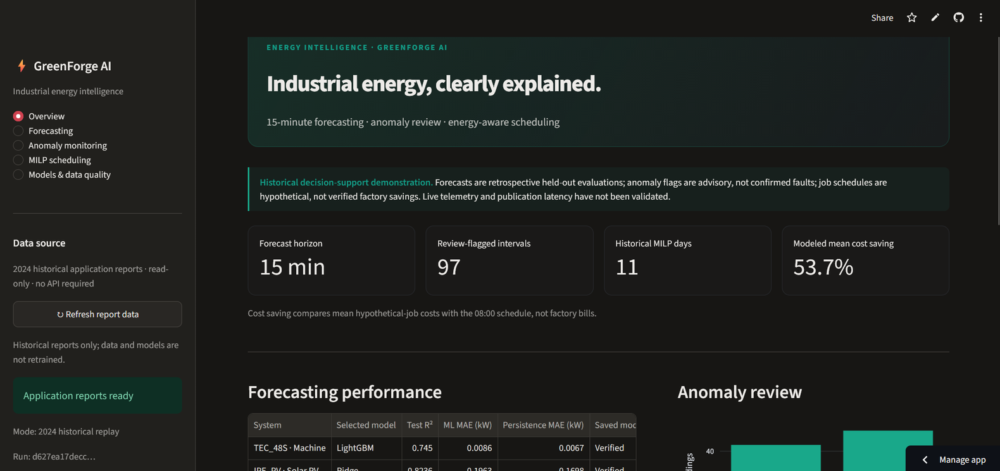
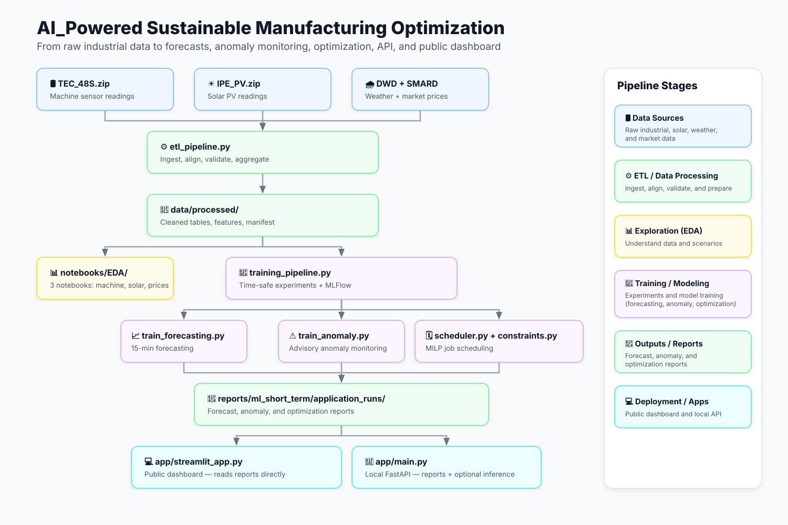

> 🚀 **[Explore the live dashboard — GreenForge AI](https://greenforge-ai.streamlit.app/)** · No setup or downloads required.

# AI_Powered Sustainable Manufacturing optimization

**GreenForge AI** · End-to-end data engineering, machine learning and energy-aware scheduling for industrial operations.

I built this project to answer a practical question: **Can a factory use its energy data to understand machine behavior, forecast short-term demand, identify unusual readings and choose better times for flexible work?**

The result is a working pipeline—from high-frequency industrial measurements to an interactive dashboard and a constrained scheduling experiment. It uses real historical energy and electricity-price records, with clear boundaries between measured findings and hypothetical decisions.

[**Live dashboard**](https://greenforge-ai.streamlit.app/) · [**How it works**](#how-the-system-works) · [**Results**](#results-at-a-glance) · [**Run locally**](#run-the-project) · [**Research questions answered**](#answers-to-the-project-questions)



## The business problem

Industrial energy is not used evenly throughout the day. Machine activity changes, solar generation varies, and electricity prices can change significantly between hours. This creates opportunities for better planning—but only if the underlying sensor readings are reliable and decisions use information that was actually available at the time.

I approached the problem in four connected steps:

1. **Make the data trustworthy.** Process large five-second sensor files, preserve missing readings and check measurement quality.
2. **Understand the operation.** Explore machine use, solar availability, weather and electricity-price patterns.
3. **Turn observations into signals.** Forecast the next 15 minutes and flag unusual readings for human review.
4. **Test a decision.** Use mixed-integer linear programming (MILP) to compare flexible job schedules against a simple 08:00 start.

The important distinction: **this is a historical decision-support prototype, not a live factory controller**. The project evaluates what could be possible; it does not claim that a real factory changed its schedule or achieved savings.

## Results at a glance

| Question | Verified project result | What it means |
|---|---:|---|
| Can machine demand be forecast 15 minutes ahead? | **R² 0.745** · LightGBM | Held-out TEC_48S machine-power evaluation |
| Can solar power be forecast 15 minutes ahead? | **R² 0.824** · Ridge | Held-out IPE_PV evaluation |
| Can unusual readings be identified for review? | **97 flagged intervals** | 44 machine + 53 solar; **not** 97 confirmed faults |
| Can flexible timing reduce modeled electricity cost? | **53.7% lower mean cost** | MILP versus an assumed 08:00 start, over **11 historical days** |
| Can the same workload need less grid electricity? | **0.210 kWh less per schedule** | Mean scenario difference, assuming access to the observed PV supply |
| What about grid-related emissions? | **0.076 kg CO₂ less per schedule** | Mean modeled difference using a pinned 2024 annual emissions factor |

*Reported application metrics come from the completed historical run `2026-11-04_16-39-21Z_d627ea17` in `reports/ml_short_term/application_runs/`.*

**The cost result in context:** The two hypothetical jobs cost an average **€0.0933** at 08:00 versus **€0.0432** with the MILP: a difference of approximately **€0.0501 per two-job schedule**. The MILP was cheaper on **9 of 11 days** and more expensive on **2**. These are small, illustrative wholesale electricity costs—not savings on actual factory bills or a company-wide return on investment.

### Forecasting: the baseline matters

| System | Selected application model | Held-out observations | R² | Model MAE (kW) | Last-reading baseline MAE (kW) |
|---|---|---:|---:|---:|---:|
| TEC_48S · machine | LightGBM | 6,584 | 0.745 | 0.0086 | **0.0067** |
| IPE_PV · solar | Ridge | 1,651 | 0.824 | 0.1963 | **0.1698** |

A simple forecast using the latest measured value has **lower overall MAE for both systems**. I kept this comparison visible rather than presenting R² alone as proof that ML is always better. The selected models perform better on *active-period MAE* and *matched-row RMSE*, but the overall MAE result shows that a low-cost baseline remains competitive. Many machine test readings are near zero, which is important when interpreting averages.

The exploratory forecasting notebook also compared more model families. Its **CatBoost** entries reached observed test R² values of **0.748 (machine)** and **0.839 (solar)**, but those notebook champions were chosen after comparing test scores. The application pipeline instead uses its **training-CV selection policy** (LightGBM and Ridge) to avoid using the held-out test period to choose the deployed candidates. **Notebook benchmark results and application results are intentionally reported separately.**

## How the system works



**The workflow in plain language:**

- **Input:** Raw machine and solar measurements from the KIT SPARK-Raw dataset, plus DWD weather and SMARD day-ahead electricity prices.
- **ETL:** Stream, normalize and validate the measurements; generate five-second cleaned data and 15-minute analytical tables.
- **Research:** Six notebooks investigate the business questions and compare modeling approaches.
- **Application pipeline:** Train and evaluate forecasting models, produce advisory anomaly-monitoring records, and solve an illustrative MILP scheduling problem.
- **Outputs:** Save versioned CSV, Parquet and JSON reports under `application_runs`; store model artifacts and metadata locally with MLflow.
- **Delivery:** Show the historical results in Streamlit; optionally use FastAPI for report endpoints and guarded saved-model inference on a local backend.

### What the main files do

| File or directory | Responsibility | Main output or consumer |
|---|---|---|
| `etl_config.json` | Defines systems, year, sensor inputs and quality settings | Used by the ETL |
| `src/greenforge_ai/ingestion/xz_to_parquet.py` | Reads large `.csv.xz` files and aligns five-second timestamps | Normalized sensor files |
| `src/greenforge_ai/ingestion/dwd_client.py` | Fetches historical weather | DWD external-data cache |
| `src/greenforge_ai/ingestion/smard_client.py` | Fetches historical market prices | SMARD external-data cache |
| `src/greenforge_ai/transformations/` | Applies units, consistency checks and missing-data rules | Validated `cleaned.parquet` |
| `src/greenforge_ai/pipelines/etl_pipeline.py` | Orchestrates ingestion, cleaning and safe publication | `data/processed/manifest.json` and Parquet outputs |
| `src/greenforge_ai/pipelines/feature_pipeline.py` | Builds complete 15-, 30- and 60-minute summaries and ML tables | `eda_*min.parquet`, `ml.parquet` |
| `src/greenforge_ai/features/` | Provides time-series features, shared-data helpers and emissions estimates | Used by notebooks and pipelines |
| `notebooks/EDA/` | Three notebooks that explore the energy and business questions | Figures and explanations |
| `notebooks/model_training/` | Three research notebooks for forecasting, anomalies and scheduling | `reports/ml_short_term/notebook_runs/` |
| `src/greenforge_ai/training/train_forecasting.py` | Builds past-only features, trains models and produces 15-minute forecasts | Prediction CSV/Parquet |
| `src/greenforge_ai/training/train_anomaly.py` | Separates bad data from unusual patterns and groups review events | Monitoring Parquet and review CSV |
| `src/greenforge_ai/training/validation.py` + `evaluation.py` | Enforces chronological evaluation and calculates fair metrics | Model evaluation records |
| `src/greenforge_ai/optimization/constraints.py` | Defines permitted job starts, duration and grid-limit assumptions | Feasibility checks |
| `src/greenforge_ai/optimization/scheduler.py` | Uses SciPy MILP to choose job times and compare scenarios | Daily cost, grid-energy and CO₂ results |
| `src/greenforge_ai/pipelines/training_pipeline.py` | Runs the three application stages and logs experiments | `application_runs/` + local `mlruns/` |
| `app/streamlit_app.py` | Displays historical forecasting, monitoring, scheduling and data quality | [Public dashboard](https://greenforge-ai.streamlit.app/) |
| `app/main.py` | Serves report endpoints and optional `/predict` inference | Local FastAPI service |
| `docker/` | Defines separate API, dashboard and MLflow-setup containers | Local Docker Compose deployment |
| `.github/workflows/ci-cd.yaml` | Runs unit tests and checks Docker builds | Continuous integration checks |
| `tests/` | Tests ETL, timing, forecasting, anomaly, API and optimizer contracts | Regression checks |

**Two sets of reports serve different purposes.** `notebook_runs/` preserves exploratory research; `application_runs/` contains the matching three-stage run consumed by the public dashboard. The cloud dashboard reads these saved reports directly and does **not** retrain models, call a private API or solve a new MILP.

## What I investigated

### 1. Exploratory data analysis

The three notebooks in [`notebooks/EDA/`](notebooks/EDA) answer the questions that shaped the modeling work:

| Notebook | Main question | Finding |
|---|---|---|
| `01_machine_telemetry_eda.ipynb` | Does the machine run continuously, and what should we investigate? | **142.7 observed hours** above 100 W, across **276 stretches**; **89.5%** lasted under an hour. Low-power readings averaged **66.9 W**. |
| `02_energy_grid_weather_eda.ipynb` | When is solar available, and how much do weather and price change? | **832.0 kWh** of observed PV generation; strongest average production around noon. Across complete price days, the median intraday spread was **€96.32/MWh**. |
| `03_plant_optimization_eda.ipynb` | How might machine demand and solar combine, and does timing matter? | On usable shared intervals, modeled machine demand was **44.10 kWh**, with **9.00 kWh** supplied by assumed shared PV and **35.10 kWh** imported from the grid. |

The notebook work also identified important caveats:

- A measured **17.658 kW** five-second machine peak had substantial missing or rejected readings nearby. It is a recorded value to investigate, not a verified startup transient or safe operating limit.
- Across **86 complete midday windows**, the solar–air-temperature correlation was about **0.06**. Without irradiance and panel temperature, this does **not** establish a heat penalty.
- The market data contained **457 negative-price hours**, but negative wholesale prices do not necessarily mean a negative customer bill.
- Only about **19.9% of the aligned machine–solar timeline** supported the shared-load comparison. PV observations cover only the early part of 2024; missing periods were not replaced with zero generation.

### 2. Machine learning and anomaly monitoring

The three notebooks in [`notebooks/model_training/`](notebooks/model_training) move from descriptive analysis to tested decision-support methods:

- **Forecasting:** Lagged power, rolling statistics and calendar features; chronological 80/20 split with a gap; training-only time-series cross-validation; comparisons with persistence. The application forecast horizon is **15 minutes**.
- **Anomalies:** Quality checks before scoring, separate lower-/higher-load models, time-ordered reference/calibration/assessment periods, and advisory review events. The research compares PCA, Local Outlier Factor, Isolation Forest and MiniBatch K-Means. The application pipeline uses the selected regime-specific models.
- **Degradation review:** Compares comparable electrical-load periods and checks inconsistent power-factor and current readings. **The dataset does not contain verified faults, maintenance histories or remaining useful life labels**, so wear cannot be confirmed.

The application reports contain **97 intervals flagged for review**: **44 for TEC_48S** (0.67% of scored assessment intervals) and **53 for IPE_PV** (3.21%). The flags help a human find records worth examining; they are not diagnoses, downtime events or validated fault-detection accuracy.

### 3. Prescriptive scheduling with MILP

The final step tests whether flexible work could be moved to a less costly time.

| Scheduling rule | Value in the experiment |
|---|---|
| Work | Two consecutive, hypothetical one-hour jobs, **1.2 kW each** (**2.4 kWh** total) |
| Baseline | Begin at **08:00** |
| Allowed window | **08:00–18:00**, Monday–Friday, 15-minute starts |
| Grid capacity | Assumed **4.0 kW** |
| Solar | Assumed to be shareable with the jobs; electrical connection **not verified** |
| Objective | Risk-weighted electricity cost, plus an illustrative emissions preference |
| Benchmark | **Hindsight**: cheapest feasible schedule using solar measured after the day ended |

At **08:00**, the optimizer can use **one genuine 15-minute-ahead PV forecast** for 08:00–08:15. For the other **39** workday intervals, it uses **patterns learned before the test period**, including conservative low- and zero-solar scenarios. It does **not** look ahead at the day's actual future solar when choosing the schedule. Later observations are used only to evaluate the decision and calculate the hindsight benchmark.

This design matters: a 15-minute forecast must not be presented as a complete ten-hour weather or production forecast. The model also assumes that archived price information was available when needed; real publication and ingestion latency have not been validated.

## Run the project

### Option A — View the dashboard immediately

**[Open GreenForge AI online](https://greenforge-ai.streamlit.app/)**. This is the easiest way to review the work. You can explore forecasting, anomaly monitoring, MILP scheduling and model/data-quality pages without downloading the raw industrial datasets.

### Option B — Run the historical dashboard locally

Clone the repository, then install only the lightweight dashboard dependencies:

```powershell
git clone https://github.com/reza-mansouri1998/GreenForge-AI.git
cd GreenForge-AI
py -3.12 -m venv .venv
.\.venv\Scripts\Activate.ps1
python -m pip install -r app/requirements.txt
Remove-Item Env:GREENFORGE_API_URL -ErrorAction SilentlyContinue
python -m streamlit run app/streamlit_app.py
```

Open **http://localhost:8501**. The dashboard uses the committed files in `reports/ml_short_term/application_runs/` and should show **Application reports ready**. No FastAPI or MLflow service is required for this mode.

### Option C — Reproduce the ETL and model training

**Prerequisites:** Python 3.12+, enough free disk space for the raw data and intermediate Parquet files, and internet access for the external weather/price sources. The CI pipeline currently tests the source code on Python 3.14. Full ETL and training are much heavier than opening the dashboard.

**1. Download only the two SPARK-Raw archives used here** from the [KIT RADAR dataset](https://radar.kit.edu/radar/en/dataset/8efkkn0g9pcng5yd):

- `TEC_48S.zip` — machine telemetry (approximately 4.3 GB in the dataset listing).
- `IPE_PV.zip` — photovoltaic measurements (approximately 85 MB in the dataset listing).

**2. Unzip both outer ZIP files** into these separate folders under the repository root:

```text
data/
 └── raw/
     └── spark_raw/
         ├── TEC_48S/      ← extracted contents of TEC_48S.zip
         └── IPE_PV/       ← extracted contents of IPE_PV.zip
```

For example, on Windows PowerShell, from the repository root:

```powershell
New-Item -ItemType Directory -Force data/raw/spark_raw/TEC_48S, data/raw/spark_raw/IPE_PV | Out-Null
Expand-Archive -Path "$env:USERPROFILE\Downloads\TEC_48S.zip" -DestinationPath data/raw/spark_raw/TEC_48S -Force
Expand-Archive -Path "$env:USERPROFILE\Downloads\IPE_PV.zip" -DestinationPath data/raw/spark_raw/IPE_PV -Force
```

The ETL searches recursively for the measurement files. **Extract the `.zip` archives, but leave the individual `.csv.xz` measurement files compressed**—the ingestion code reads those directly. The raw datasets are intentionally not stored in GitHub.

**3. Install the full project dependencies** (from the repository root, in your activated Python environment):

```powershell
python -m pip install --upgrade pip
python -m pip install -r requirements.txt
```

**4. Run the pipeline:**

```powershell
python -m greenforge_ai.pipelines.etl_pipeline --config etl_config.json
python -m greenforge_ai.pipelines.training_pipeline --stage all --compare-forecast-candidates
```

The ETL publishes validated outputs under `data/processed/`. The application training pipeline then writes one matching three-stage run under `reports/ml_short_term/application_runs/` and tracks model artifacts in local `mlruns/`.

> **Reproducibility note:** `etl_config.json` references `publisher_schema.json` for publisher-specific sensor validation, but that schema was **not present in the supplied project archive reviewed for this README**. Restore the correct file at the configured path before running the full ETL; otherwise its configuration check will stop. You do not need this file for the already-deployed historical dashboard.

### Option D — Run the dashboard through local FastAPI

With the full project environment installed and a complete `application_runs` folder available, open two terminals:

**Terminal 1 — backend**

```powershell
python -m uvicorn app.main:app --reload --port 8000
```

**Terminal 2 — dashboard**

```powershell
$env:GREENFORGE_API_URL = "http://127.0.0.1:8000"
python -m streamlit run app/streamlit_app.py
```

FastAPI documentation: **http://127.0.0.1:8000/docs** · Dashboard: **http://localhost:8501**.

The API exposes read-only historical report endpoints and an optional guarded `POST /api/v1/predict/{system}` endpoint. **New inference requires the matching local MLflow database and saved models**; historical report viewing does not.

The optional Docker Compose stack is defined in `docker/compose.yaml`:

```powershell
 docker compose -f docker/compose.yaml up --build
```

This local stack mounts the historical reports and MLflow storage from the host. It requires those files to exist locally; **Docker images, the local MLflow service and FastAPI are not hosted by the public Streamlit deployment**.

## Tools and engineering practices

| Area | Tools | How they were used |
|---|---|---|
| Data ingestion and processing | **Python, DuckDB, Polars, Pandas, NumPy, PyArrow** | Stream large sensor files, validate observations, aggregate time series, store Parquet |
| External data | **DWD, SMARD, Requests** | Historical weather and day-ahead market prices |
| Forecasting | **scikit-learn, LightGBM, CatBoost, XGBoost** | Time-series features, model comparisons, held-out evaluation and persistence baselines |
| Anomaly monitoring | **scikit-learn** (PCA, LOF, Isolation Forest, K-Means) | Regime-specific unsupervised review signals |
| Optimization | **SciPy / HiGHS, NumPy** | Mixed-integer scheduling with explicit constraints |
| Experiments and serving | **MLflow, FastAPI, Uvicorn, Streamlit, Plotly** | Saved-model tracking, HTTP API, interactive dashboard |
| Quality and delivery | **pytest, GitHub Actions, Docker, Docker Compose** | Automated tests, Docker image builds and reproducible local services |

The ETL checks measurement units, completeness, timestamp alignment and data lineage. It publishes outputs with checksums and atomic file replacement. Forecast features are built only from prior measurements, evaluations use chronological splits, and historical monitoring records carry availability timestamps so future information cannot be used prematurely.

GitHub Actions runs isolated unit tests and validates the three lightweight Docker build targets. **It is a CI workflow, not a cloud backend deployment pipeline.** Streamlit Community Cloud separately redeploys the public dashboard when the connected GitHub branch is updated.

## Answers to the project questions

**1. How does the machine use electricity?**  
It does not show continuous high-power use. We observed **276 higher-power stretches** and **142.7 hours above 100 W**. This gives an evidence-based picture of activity, but production logs are needed to identify actual jobs, idle waste or allowable schedule changes.

**2. When are solar generation and electricity prices favorable?**  
Average observed solar production was strongest near **12:00**, while the cheapest average market-price hour was **13:00** in the available price history. Price variation creates a potential incentive to shift flexible demand, but the solar and price records span different periods and a factory's tariff is unknown.

**3. Can temperature explain a drop in solar efficiency?**  
**Not with these data.** The midday air-temperature correlation was only **0.06** across 86 complete windows. Irradiance and actual panel temperature are missing, so a temperature-related efficiency penalty cannot be isolated.

**4. Could solar power reduce the machine's grid imports?**  
Under the **unverified shared-connection assumption**, usable intervals contained **44.10 kWh** of demand: **9.00 kWh** offset by modeled local PV and **35.10 kWh** requiring grid imports. That is a scenario covering a limited overlap period, not a verified whole-plant energy balance.

**5. Can machine and solar power be forecast 15 minutes ahead?**  
**Yes, historically, with useful—but imperfect—skill:** application-model test R² was **0.745** for TEC_48S and **0.824** for IPE_PV. The last-reading baseline still wins on overall MAE, so the results justify further evaluation rather than a claim of universal ML superiority.

**6. Can unusual behavior or degradation be detected?**  
The pipeline found **97 review-flagged intervals** and made them explorable in a dashboard. It cannot establish the number of equipment failures or predict remaining useful life. The electrical-condition study also surfaced sensor inconsistencies that need independent engineering checks.

**7. Can an optimizer recommend better working hours?**  
**Within the stated hypothetical scheduling rules, yes.** On 11 matched historical days, MILP produced **53.7% lower average modeled wholesale cost** than starting the same two jobs at 08:00, along with a mean reduction of **0.210 kWh** in grid imports and **0.076 kg** in annual-factor estimated CO₂ per schedule. The result is a successful **decision-support experiment**, not proof of realized factory savings.

## Limitations and next steps

The main missing inputs for real operation are **verified production orders and deadlines, permitted operating windows, equipment safety rules, actual tariffs, confirmed electrical connectivity, full-horizon solar/weather forecasts and measured data/publication latency**. The solar data used here cover only part of 2024. No fault labels, maintenance histories or actual factory dispatch records are available.

A practical next version would add those inputs, validate forecasting on a new time period, test the optimizer on real production constraints, and measure the outcome in a controlled operational pilot.

## Data sources, attribution and license

**Industrial measurements.** Sievers, J., Blank, T., Bischof, S., et al. (2026). *SPARK-Raw: Unprocessed High-Resolution Energy Data from a Sustainable Industrial Production Area in Karlsruhe*. Karlsruhe Institute of Technology. [Dataset page](https://radar.kit.edu/radar/en/dataset/8efkkn0g9pcng5yd) · [DOI: 10.35097/8efkkn0g9pcng5yd](https://doi.org/10.35097/8efkkn0g9pcng5yd). The dataset is licensed **CC BY 4.0**. Raw measurements are obtained from the publisher, not redistributed in this repository.

**Other inputs.** Historical weather information comes from the German Weather Service (DWD); electricity-price context comes from the German SMARD archive. The CO₂ comparison uses the **0.363 kg CO₂/kWh** factor from the [German Environment Agency's 9 April 2025 publication for 2024](https://www.umweltbundesamt.de/themen/co2-emissionen-pro-kilowattstunde-strom-2024). That specific published factor is pinned for reproducibility; later UBA revisions may report different values. This is an annual generation-related estimate, **not** hourly marginal emissions or measured avoided CO₂.

**Project code.** Available under the repository's [MIT License](LICENSE).

---

**GreenForge AI** · From raw industrial measurements to clear, testable energy decisions.  
**[See the running application →](https://greenforge-ai.streamlit.app/)**
